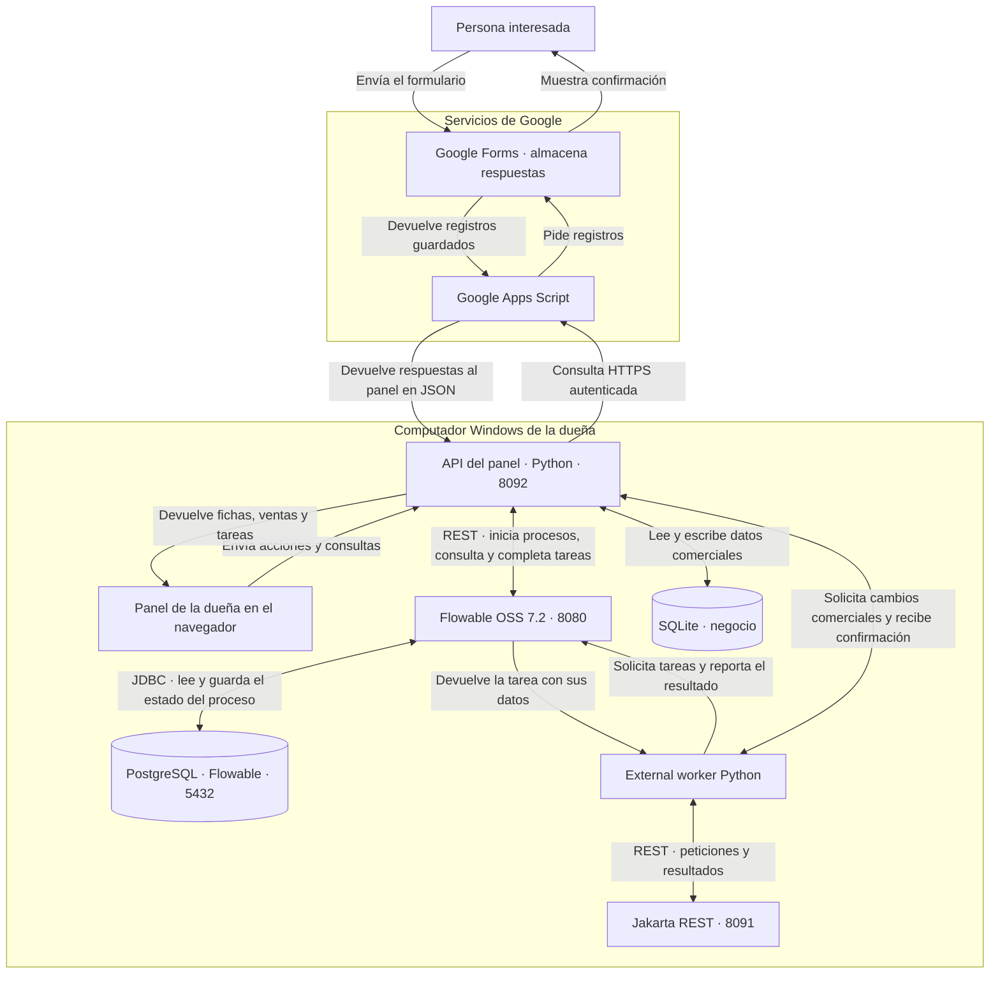

# Arquitectura

## Quién hace qué

| Participante o componente | Qué hace en Peluditos |
| --- | --- |
| Persona interesada | Completa el formulario con sus datos de contacto y los de su mascota. Pasa a ser cliente cuando concreta su primera compra. |
| Google Forms | Muestra las preguntas, guarda las respuestas y confirma el envío en el navegador. |
| Google Apps Script | Atiende la consulta de la API del panel, lee las respuestas de Forms y devuelve las nuevas. |
| Dueña del negocio | Conversa con los interesados, revisa los mensajes de cumpleaños y registra si hubo compra. |
| Panel de la dueña | Es la pantalla donde ve contactos, calendario y tareas. Envía sus acciones a la API. |
| API del panel | Recoge los registros de Google, lee y guarda las fichas en SQLite, e inicia procesos, consulta tareas y comunica a Flowable las decisiones de la dueña. |
| Flowable | Lleva el orden de los pasos. Pone a disposición del worker las tareas automáticas y deja las tareas humanas en la bandeja hasta que la dueña las completa. |
| External worker | Pide trabajo a Flowable, recibe la tarea con sus datos, llama al servicio que necesita y comunica el resultado al motor. |
| Servicio Java | Genera el cupón o el mensaje, simula el envío del correo y devuelve el estado que corresponde al resultado de una venta. |
| SQLite | Guarda fichas, cumpleaños, ventas, oportunidades y el punto hasta donde llegó la importación del formulario. |
| PostgreSQL | Guarda el avance de Flowable. Así se puede retomar una tarea pendiente después de reiniciar el motor. |

## Cómo llega una respuesta al panel

1. La persona interesada envía el formulario público con sus datos y los de su mascota. Google Forms guarda la respuesta y muestra una confirmación en su navegador.
2. Al abrir el panel con la conexión configurada, el navegador solicita la sincronización. Repite la consulta cada 30 segundos mientras sigue abierto. La dueña también puede pulsar **Actualizar respuestas**.
3. La API del panel lee en SQLite el punto hasta el que importó y hace una consulta HTTPS autenticada a Apps Script. Apps Script pide las respuestas guardadas a Google Forms y devuelve las nuevas a la API en JSON. Si el panel está cerrado, Google Forms conserva los envíos para la próxima consulta.
4. Por cada registro válido que aún no se ha importado, la API inicia una instancia de **Gestión de Leads** en Flowable. El worker obtiene la tarea de guardar la ficha y se la envía a la API, que la registra en SQLite con estado pendiente. En la siguiente tarea, el worker pide el cupón a Java, simula el envío y guarda el código en la ficha a través de la API.
5. La bandeja reúne dos consultas. Para mostrar la ficha, la API lee SQLite. Para mostrar la tarea **Conversar y registrar resultado**, consulta a Flowable. Cuando la dueña registra la compra o cierra el seguimiento, la API completa la tarea humana en Flowable y el worker ejecuta la actualización comercial que corresponda.

La dueña también puede registrar un interesado a mano en el panel. En ese caso la API inicia el mismo proceso con los datos que ingresó la dueña.

## Qué recibe el external worker

El worker se suscribe a los tipos de tarea que sabe ejecutar y consulta a Flowable. Cuando hay trabajo, Flowable responde con la tarea y sus variables. Según la tarea, el worker llama al servicio Java, pide a la API del panel que guarde datos, o hace ambas cosas. Al terminar informa el resultado a Flowable. Así el motor sabe cuándo avanzar a la siguiente actividad. [Implementación del worker](../worker-python/worker.py)

## Cómo se prepara un cumpleaños

El panel muestra los cumpleaños próximos de mascotas de clientes. La dueña pulsa **Preparar correo**, revisa el borrador y pulsa **Iniciar tareas de envío**. La API inicia una oportunidad en Flowable por destinatario con correo. Los 15 días corresponden al aviso del calendario. El proceso BPMN arranca con la acción de la dueña.

Para cada oportunidad, Flowable entrega al worker la tarea de generar una sugerencia. El worker llama al servicio Java, recibe el texto y lo devuelve a Flowable. La dueña puede verlo en **Ver sugerencia del servicio** y decidir el envío desde la bandeja. Si lo aprueba, el worker solicita a Java la simulación del correo y pide a la API que abra el seguimiento. Si después se registra una venta, esta queda asociada a la oportunidad en SQLite. [Proceso de cumpleaños y eventos](../BPMN/oportunidades-fechas.bpmn)

## Conexiones del diagrama

Una punta indica el sentido del mensaje escrito en la flecha. Dos puntas resumen una operación con intercambio en ambos sentidos.

El diagrama corresponde al despliegue Windows configurado con el instalador 08. **PostgreSQL** guarda la ejecución de Flowable, incluidas las instancias, las variables, las tareas y el historial. **SQLite** guarda los datos comerciales y el progreso de la importación del formulario. La API del panel se encarga de leer y escribir en SQLite. Los puertos de la imagen son los del despliegue de referencia. [Guía de despliegue](../docs/despliegue.md)
