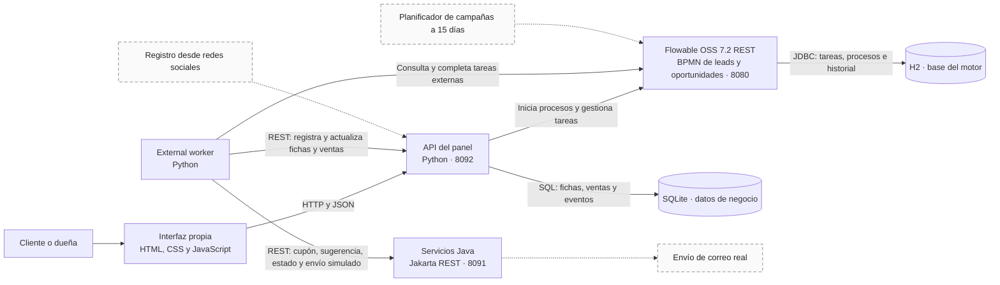

[README.md](https://github.com/user-attachments/files/34608472/README.md)
# Arquitectura de Peluditos Pet Chile

diagrama en Mermaid 

Las cajas de borde continuo son componentes implementados. Las cajas y flechas discontinuas representan ampliaciones planificadas. El recorrido de oportunidades se inicia desde el panel y el servicio Java simula el envío.

H2 conserva las definiciones, instancias, tareas e historial del motor. SQLite conserva los datos comerciales. El panel es el único componente que abre SQLite. El worker actualiza los datos mediante la API del panel. Consulta [las decisiones de almacenamiento y la prueba](../docs/persistencia.md).
